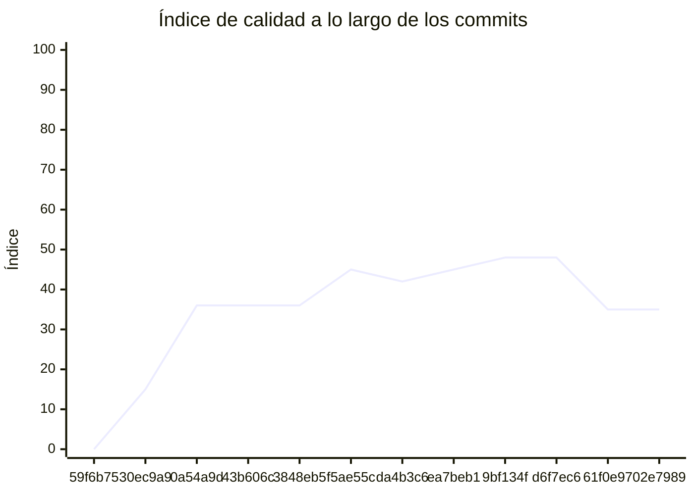

<!-- evaluacion:inicio -->
# Evaluación — prog-2-SQR/Frontend-KMP

> Documento **generado automáticamente** por la cátedra de Programación II (UM): RepoSense + análisis de calidad de **7 dimensiones**. **No editar a mano**: se regenera en cada evaluación.
> Rama evaluada: `main`. Análisis **heurístico** (regex + métricas) + build: es una criba para orientar la revisión, **no una nota**. La **documentación** del repositorio no se evalúa.
> Generado: 2026-11-12.

## 1. Veredicto

| Aspecto | Resultado |
|---|---|
| Índice de calidad | **43/100** |
| Tipo de repositorio | `app-kmp` |
| Build (`mvnw verify` / `gradlew check`) | OK |
| Código (LOC) | 4,429 |
| Archivos de código | 88 |
| Clases | 108 |
| Código dentro de clases (%POO) | 67% |
| Funciones fuera de clases | 18 |
| Duplicación (puerta) | 2.4% |
| Duplicación lógica | 2.5% |
| Duplicación de boilerplate | 13.8% |
| Cobertura | 48% |
| Tope duro aplicado a D1 | `SUELTAS>=10` → D1 ≤ 20 |

> Este informe **describe** lo que el análisis midió con los criterios ya establecidos de la materia. No es una nota.

## 2. Semáforo de aprobación

Criterios de la cátedra (`CRITERIOS-CALIDAD.md`): **Aprobar** se juega con el perfil `estandar`; **destacar**, con el `exigente` (meta de excelencia).

| Semáforo | Resultado |
|---|---|
| Aprobar (`estandar`) | **no cumple** — 4/11 |
| Destacar (`exigente`) | **no cumple** — 2/11 |

**Para aprobar, falta cumplir:** SOLID; MVVM; SEC; Cobertura

**Para destacar, falta cumplir:** SOLID; POO; MVVM; Duplicación; SEC; Cobertura

## 3. Autoría (RepoSense)

| Autor | Commits | Código (LOC) | Tests (LOC) | Docs (LOC) | Días activos | % del código |
|---|---:|---:|---:|---:|---:|---:|
| Santiago Quiroga Rivarossa | 40 | 5,215 | 0 | 268 | 11 | 100% |

> _El LOC de autoría lo calcula RepoSense sobre el historial y puede diferir del LOC de código del análisis (que mira el estado de `main`)._

## 4. Dimensiones evaluadas

Cada dimensión indica **qué mide**, **por qué importa** y **tu resultado**. Cuando el puntaje queda por debajo de la referencia, se agregan preguntas para **investigar la causa** (no hay recetas).

| Dimensión | Peso | Puntaje |
|:--|--:|--:|
| **D1** Diseño OO, SOLID y patrones (20%) | 20% | 2 |
| **D2** Arquitectura hexagonal — backend (15%) | 15% | N/A |
| **D3** Frontend KMP: MVVM y buenas prácticas (10%) | 10% | 67 |
| **D4** Integración y contrato (10%) | 10% | N/A |
| **D5** Seguridad y robustez (10%) | 10% | 0 |
| **D6** Pruebas y cobertura (20%) | 20% | 80 |
| **D7** Proceso y entrega (15%) | 15% | 62 |

### D1. Diseño OO, SOLID y patrones (20%)

- **Qué mide:** Métricas orientadas a objetos (clases, métodos, campos, cohesión, acoplamiento, herencia) y proxies de SOLID, más patrones de diseño.
- **Por qué importa:** El eje de la materia es el buen uso de la POO y su arquitectura: un diseño con clases claras y poco acopladas es más fácil de entender, probar y cambiar.
- **Tu resultado:** **2/100**
- **Para investigar la causa:**
    - ¿Se pensó el modelo de clases antes de codificar o se agrupó después?
    - ¿Qué clases concentran muchas responsabilidades a la vez?
    - ¿Los colaboradores llegan como parámetros o se crean por dentro?

### D3. Frontend KMP: MVVM y buenas prácticas (10%)

- **Qué mide:** Uso de ViewModel, estado de UI y flujo unidireccional, y ausencia de acceso a red/BD dentro de la UI.
- **Por qué importa:** Separar la UI del estado y del acceso a datos hace la app más predecible, testeable y menos propensa a bugs de ciclo de vida.
- **Tu resultado:** **67/100**

### D5. Seguridad y robustez (10%)

- **Qué mide:** Credenciales embebidas, consultas SQL por concatenación, y presencia de config de entorno; aislamiento de secretos.
- **Por qué importa:** Un secreto en el repositorio o una consulta construida por concatenación son riesgos concretos, no hipotéticos.
- **Tu resultado:** **0/100**
- **Para investigar la causa:**
    - ¿De dónde salen las credenciales que usa el sistema?
    - ¿Qué consultas se arman con texto en vez de parámetros?
    - ¿Qué pasa si falta una variable de entorno al arrancar?

### D6. Pruebas y cobertura (20%)

- **Qué mide:** Cantidad y resultado de pruebas y cobertura de línea (JaCoCo/Kover, Surefire/Failsafe) cuando hay build.
- **Por qué importa:** Las pruebas son la red de seguridad para refactorizar e integrar; la cobertura acota las zonas sin verificar.
- **Tu resultado:** **80/100**

### D7. Proceso y entrega (15%)

- **Qué mide:** Artefactos verificables de proceso/entrega: `compose`, `.env.example`, CI (`.github/workflows/`), `CODEOWNERS` y wrapper de build (`mvnw`/`gradlew`). **No** puntúa documentación.
- **Por qué importa:** Un proyecto que compila, se levanta y se valida solo es más fácil de revisar y de integrar en equipo.
- **Tu resultado:** **62/100**

## 5. Señales detectadas

El análisis encontró las siguientes señales (archivo, sin número de línea a propósito):

**SRP/responsabilidad** (46)
- función 'App' de 35 líneas — `shared/src/commonMain/kotlin/ar/edu/um/prog2/quiroga/turnosapp/App.kt`
- clase 'LoginUiState' sin métodos (7 campos): solo datos — `shared/src/commonMain/kotlin/ar/edu/um/prog2/quiroga/turnosapp/viewmodel/LoginViewModel.kt`
- clase 'ReservationDetailUiState' grande (LOC=18, métodos=0, campos=13) — `shared/src/commonMain/kotlin/ar/edu/um/prog2/quiroga/turnosapp/viewmodel/ReservationDetailViewModel.kt`
- clase 'ReservationDetailUiState' sin métodos (13 campos): solo datos — `shared/src/commonMain/kotlin/ar/edu/um/prog2/quiroga/turnosapp/viewmodel/ReservationDetailViewModel.kt`
- clase 'RegisterFieldErrors' sin métodos (7 campos): solo datos — `shared/src/commonMain/kotlin/ar/edu/um/prog2/quiroga/turnosapp/viewmodel/RegisterViewModel.kt`
- clase 'RegisterUiState' grande (LOC=62, métodos=8, campos=13) — `shared/src/commonMain/kotlin/ar/edu/um/prog2/quiroga/turnosapp/viewmodel/RegisterViewModel.kt`
- clase 'MyReservationsUiState' sin métodos (7 campos): solo datos — `shared/src/commonMain/kotlin/ar/edu/um/prog2/quiroga/turnosapp/viewmodel/MyReservationsViewModel.kt`
- clase 'SearchUiState' grande (LOC=12, métodos=1, campos=8) — `shared/src/commonMain/kotlin/ar/edu/um/prog2/quiroga/turnosapp/viewmodel/SearchViewModel.kt`
- clase 'SearchViewModel' grande (LOC=47, métodos=11, campos=4) — `shared/src/commonMain/kotlin/ar/edu/um/prog2/quiroga/turnosapp/viewmodel/SearchViewModel.kt`
- clase 'SearchViewModel' con baja cohesión (27%) — `shared/src/commonMain/kotlin/ar/edu/um/prog2/quiroga/turnosapp/viewmodel/SearchViewModel.kt`
- clase 'AvailabilityUiState' grande (LOC=20, métodos=1, campos=12) — `shared/src/commonMain/kotlin/ar/edu/um/prog2/quiroga/turnosapp/viewmodel/AvailabilityViewModel.kt`
- clase 'ConfirmationState' sin métodos (7 campos): solo datos — `shared/src/commonMain/kotlin/ar/edu/um/prog2/quiroga/turnosapp/viewmodel/AvailabilityViewModel.kt`
- clase 'AvailabilityViewModel' grande (LOC=82, métodos=10, campos=6) — `shared/src/commonMain/kotlin/ar/edu/um/prog2/quiroga/turnosapp/viewmodel/AvailabilityViewModel.kt`
- clase 'AvailabilityViewModel' con baja cohesión (47%) — `shared/src/commonMain/kotlin/ar/edu/um/prog2/quiroga/turnosapp/viewmodel/AvailabilityViewModel.kt`
- clase 'KtorAppointmentRepository' grande (LOC=88, métodos=6, campos=19) — `shared/src/commonMain/kotlin/ar/edu/um/prog2/quiroga/turnosapp/data/repository/KtorAppointmentRepository.kt`
- clase 'KtorAuthRepository' con baja cohesión (17%) — `shared/src/commonMain/kotlin/ar/edu/um/prog2/quiroga/turnosapp/data/repository/KtorAuthRepository.kt`
- clase 'KtorProfessionalRepository' con baja cohesión (40%) — `shared/src/commonMain/kotlin/ar/edu/um/prog2/quiroga/turnosapp/data/repository/KtorProfessionalRepository.kt`
- clase 'AppColors' grande (LOC=18, métodos=0, campos=8) — `shared/src/commonMain/kotlin/ar/edu/um/prog2/quiroga/turnosapp/ui/theme/AppColors.kt`
- clase 'AppColors' sin métodos (8 campos): solo datos — `shared/src/commonMain/kotlin/ar/edu/um/prog2/quiroga/turnosapp/ui/theme/AppColors.kt`
- clase 'AppDestination' sin métodos (4 campos): solo datos — `shared/src/commonMain/kotlin/ar/edu/um/prog2/quiroga/turnosapp/ui/navigation/AppDestination.kt`
- clase 'AuthScreen' sin métodos (5 campos): solo datos — `shared/src/commonMain/kotlin/ar/edu/um/prog2/quiroga/turnosapp/ui/screens/AuthScreen.kt`
- clase 'AvailabilityScreen' con baja cohesión (29%) — `shared/src/commonMain/kotlin/ar/edu/um/prog2/quiroga/turnosapp/ui/screens/AvailabilityScreen.kt`
- método 'ReservationDetailScreen.Content' de 30 líneas — `shared/src/commonMain/kotlin/ar/edu/um/prog2/quiroga/turnosapp/ui/screens/ReservationDetailScreen.kt`
- método 'ReservationDetailScreen.Content' con complejidad 6 — `shared/src/commonMain/kotlin/ar/edu/um/prog2/quiroga/turnosapp/ui/screens/ReservationDetailScreen.kt`
- clase 'LoginScreen' sin métodos (3 campos): solo datos — `shared/src/commonMain/kotlin/ar/edu/um/prog2/quiroga/turnosapp/ui/screens/LoginScreen.kt`
- clase 'MainScreen' grande (LOC=125, métodos=1, campos=17) — `shared/src/commonMain/kotlin/ar/edu/um/prog2/quiroga/turnosapp/ui/screens/MainScreen.kt`
- clase 'RegisterScreen' sin métodos (4 campos): solo datos — `shared/src/commonMain/kotlin/ar/edu/um/prog2/quiroga/turnosapp/ui/screens/RegisterScreen.kt`
- método 'SearchScreen.Filters' de 35 líneas — `shared/src/commonMain/kotlin/ar/edu/um/prog2/quiroga/turnosapp/ui/screens/SearchScreen.kt`
- clase 'PhoneRules' sin métodos (3 campos): solo datos — `shared/src/commonMain/kotlin/ar/edu/um/prog2/quiroga/turnosapp/domain/validation/PhoneRules.kt`
- clase 'ProfessionalPage' sin métodos (7 campos): solo datos — `shared/src/commonMain/kotlin/ar/edu/um/prog2/quiroga/turnosapp/domain/model/ProfessionalPage.kt`
- clase 'NewReservation' sin métodos (6 campos): solo datos — `shared/src/commonMain/kotlin/ar/edu/um/prog2/quiroga/turnosapp/domain/model/Reservation.kt`
- clase 'Reservation' grande (LOC=17, métodos=0, campos=10) — `shared/src/commonMain/kotlin/ar/edu/um/prog2/quiroga/turnosapp/domain/model/Reservation.kt`
- clase 'Reservation' sin métodos (10 campos): solo datos — `shared/src/commonMain/kotlin/ar/edu/um/prog2/quiroga/turnosapp/domain/model/Reservation.kt`
- clase 'ReservationPage' sin métodos (6 campos): solo datos — `shared/src/commonMain/kotlin/ar/edu/um/prog2/quiroga/turnosapp/domain/model/Reservation.kt`
- clase 'Professional' sin métodos (6 campos): solo datos — `shared/src/commonMain/kotlin/ar/edu/um/prog2/quiroga/turnosapp/domain/model/Professional.kt`
- clase 'AvailabilityViewModelTest' grande (LOC=151, métodos=17, campos=3) — `shared/src/commonTest/kotlin/ar/edu/um/prog2/quiroga/turnosapp/viewmodel/AvailabilityViewModelTest.kt`
- clase 'ReservationDetailViewModelTest' grande (LOC=146, métodos=15, campos=2) — `shared/src/commonTest/kotlin/ar/edu/um/prog2/quiroga/turnosapp/viewmodel/ReservationDetailViewModelTest.kt`
- clase 'FakeAppointmentRepository' grande (LOC=67, métodos=6, campos=15) — `shared/src/commonTest/kotlin/ar/edu/um/prog2/quiroga/turnosapp/viewmodel/FakeAppointmentRepository.kt`
- clase 'FakeAppointmentRepository' con baja cohesión (20%) — `shared/src/commonTest/kotlin/ar/edu/um/prog2/quiroga/turnosapp/viewmodel/FakeAppointmentRepository.kt`
- clase 'MyReservationsViewModelTest' con baja cohesión (48%) — `shared/src/commonTest/kotlin/ar/edu/um/prog2/quiroga/turnosapp/viewmodel/MyReservationsViewModelTest.kt`
- clase 'FakeAuthRepository' grande (LOC=27, métodos=4, campos=8) — `shared/src/commonTest/kotlin/ar/edu/um/prog2/quiroga/turnosapp/viewmodel/FakeAuthRepository.kt`
- clase 'FakeAuthRepository' con baja cohesión (17%) — `shared/src/commonTest/kotlin/ar/edu/um/prog2/quiroga/turnosapp/viewmodel/FakeAuthRepository.kt`
- clase 'SearchViewModelTest' grande (LOC=90, métodos=10, campos=1) — `shared/src/commonTest/kotlin/ar/edu/um/prog2/quiroga/turnosapp/viewmodel/SearchViewModelTest.kt`
- clase 'KtorProfessionalRepositoryTest' grande (LOC=87, métodos=10, campos=1) — `shared/src/commonTest/kotlin/ar/edu/um/prog2/quiroga/turnosapp/data/repository/KtorProfessionalRepositoryTest.kt`
- clase 'KtorAuthRepositoryTest' grande (LOC=111, métodos=16, campos=5) — `shared/src/commonTest/kotlin/ar/edu/um/prog2/quiroga/turnosapp/data/repository/KtorAuthRepositoryTest.kt`
- clase 'KtorAuthRepositoryTest' con baja cohesión (31%) — `shared/src/commonTest/kotlin/ar/edu/um/prog2/quiroga/turnosapp/data/repository/KtorAuthRepositoryTest.kt`

**POO** (41)
- clase 'LoginUiState' con 7 campos públicos (encapsulación) — `shared/src/commonMain/kotlin/ar/edu/um/prog2/quiroga/turnosapp/viewmodel/LoginViewModel.kt`
- clase 'ReservationDetailUiState' con 13 campos públicos (encapsulación) — `shared/src/commonMain/kotlin/ar/edu/um/prog2/quiroga/turnosapp/viewmodel/ReservationDetailViewModel.kt`
- clase 'RegisterFieldErrors' con 7 campos públicos (encapsulación) — `shared/src/commonMain/kotlin/ar/edu/um/prog2/quiroga/turnosapp/viewmodel/RegisterViewModel.kt`
- clase 'RegisterUiState' con 11 campos públicos (encapsulación) — `shared/src/commonMain/kotlin/ar/edu/um/prog2/quiroga/turnosapp/viewmodel/RegisterViewModel.kt`
- clase 'MyReservationsUiState' con 7 campos públicos (encapsulación) — `shared/src/commonMain/kotlin/ar/edu/um/prog2/quiroga/turnosapp/viewmodel/MyReservationsViewModel.kt`
- clase 'SearchUiState' con 8 campos públicos (encapsulación) — `shared/src/commonMain/kotlin/ar/edu/um/prog2/quiroga/turnosapp/viewmodel/SearchViewModel.kt`
- clase 'AvailabilityUiState' con 12 campos públicos (encapsulación) — `shared/src/commonMain/kotlin/ar/edu/um/prog2/quiroga/turnosapp/viewmodel/AvailabilityViewModel.kt`
- clase 'ConfirmationState' con 7 campos públicos (encapsulación) — `shared/src/commonMain/kotlin/ar/edu/um/prog2/quiroga/turnosapp/viewmodel/AvailabilityViewModel.kt`
- clase 'KtorAppointmentRepository' con 15 campos públicos (encapsulación) — `shared/src/commonMain/kotlin/ar/edu/um/prog2/quiroga/turnosapp/data/repository/KtorAppointmentRepository.kt`
- clase 'KtorProfessionalRepository' con 5 campos públicos (encapsulación) — `shared/src/commonMain/kotlin/ar/edu/um/prog2/quiroga/turnosapp/data/repository/KtorProfessionalRepository.kt`
- clase 'AppDestination' con 4 campos públicos (encapsulación) — `shared/src/commonMain/kotlin/ar/edu/um/prog2/quiroga/turnosapp/ui/navigation/AppDestination.kt`
- clase 'MyReservationsScreen' con 4 campos públicos (encapsulación) — `shared/src/commonMain/kotlin/ar/edu/um/prog2/quiroga/turnosapp/ui/screens/MyReservationsScreen.kt`
- clase 'AuthScreen' con 5 campos públicos (encapsulación) — `shared/src/commonMain/kotlin/ar/edu/um/prog2/quiroga/turnosapp/ui/screens/AuthScreen.kt`
- clase 'MainScreen' con 18 campos públicos (encapsulación) — `shared/src/commonMain/kotlin/ar/edu/um/prog2/quiroga/turnosapp/ui/screens/MainScreen.kt`
- clase 'RegisterScreen' con 4 campos públicos (encapsulación) — `shared/src/commonMain/kotlin/ar/edu/um/prog2/quiroga/turnosapp/ui/screens/RegisterScreen.kt`
- clase 'ProfessionalPage' con 7 campos públicos (encapsulación) — `shared/src/commonMain/kotlin/ar/edu/um/prog2/quiroga/turnosapp/domain/model/ProfessionalPage.kt`
- clase 'NewReservation' con 6 campos públicos (encapsulación) — `shared/src/commonMain/kotlin/ar/edu/um/prog2/quiroga/turnosapp/domain/model/Reservation.kt`
- clase 'Reservation' con 10 campos públicos (encapsulación) — `shared/src/commonMain/kotlin/ar/edu/um/prog2/quiroga/turnosapp/domain/model/Reservation.kt`
- clase 'ReservationPage' con 6 campos públicos (encapsulación) — `shared/src/commonMain/kotlin/ar/edu/um/prog2/quiroga/turnosapp/domain/model/Reservation.kt`
- clase 'Professional' con 6 campos públicos (encapsulación) — `shared/src/commonMain/kotlin/ar/edu/um/prog2/quiroga/turnosapp/domain/model/Professional.kt`
- clase 'FakeAppointmentRepository' con 15 campos públicos (encapsulación) — `shared/src/commonTest/kotlin/ar/edu/um/prog2/quiroga/turnosapp/viewmodel/FakeAppointmentRepository.kt`
- clase 'FakeProfessionalRepository' con 6 campos públicos (encapsulación) — `shared/src/commonTest/kotlin/ar/edu/um/prog2/quiroga/turnosapp/viewmodel/FakeProfessionalRepository.kt`
- clase 'FakeAuthRepository' con 8 campos públicos (encapsulación) — `shared/src/commonTest/kotlin/ar/edu/um/prog2/quiroga/turnosapp/viewmodel/FakeAuthRepository.kt`
- función 'tokenExpiringAt' fuera de una clase — `shared/src/commonTest/kotlin/ar/edu/um/prog2/quiroga/turnosapp/data/local/InMemorySessionStore.kt`
- función 'reserveSendsTheSlotAndReturnsTheProcess' fuera de una clase — `shared/src/commonTest/kotlin/ar/edu/um/prog2/quiroga/turnosapp/data/repository/KtorAppointmentRepositoryTest.kt`
- función 'reserveSendsThePatientNamesWhenGiven' fuera de una clase — `shared/src/commonTest/kotlin/ar/edu/um/prog2/quiroga/turnosapp/data/repository/KtorAppointmentRepositoryTest.kt`
- función 'anUnknownStatusDoesNotBreakTheApp' fuera de una clase — `shared/src/commonTest/kotlin/ar/edu/um/prog2/quiroga/turnosapp/data/repository/KtorAppointmentRepositoryTest.kt`
- función 'aTakenSlotAsksToChooseAnother' fuera de una clase — `shared/src/commonTest/kotlin/ar/edu/um/prog2/quiroga/turnosapp/data/repository/KtorAppointmentRepositoryTest.kt`
- función 'aPendingReservationIsExplained' fuera de una clase — `shared/src/commonTest/kotlin/ar/edu/um/prog2/quiroga/turnosapp/data/repository/KtorAppointmentRepositoryTest.kt`
- función 'missingNamesAreFlaggedSoTheAppCanAskForThem' fuera de una clase — `shared/src/commonTest/kotlin/ar/edu/um/prog2/quiroga/turnosapp/data/repository/KtorAppointmentRepositoryTest.kt`
- función 'otherErrorsDoNotAskForNames' fuera de una clase — `shared/src/commonTest/kotlin/ar/edu/um/prog2/quiroga/turnosapp/data/repository/KtorAppointmentRepositoryTest.kt`
- función 'expiredSessionAsksToLogInAgain' fuera de una clase — `shared/src/commonTest/kotlin/ar/edu/um/prog2/quiroga/turnosapp/data/repository/KtorAppointmentRepositoryTest.kt`
- función 'catalogOrCatedraDownIsExplained' fuera de una clase — `shared/src/commonTest/kotlin/ar/edu/um/prog2/quiroga/turnosapp/data/repository/KtorAppointmentRepositoryTest.kt`
- función 'anUnknownErrorShowsAGenericMessageWithoutInternals' fuera de una clase — `shared/src/commonTest/kotlin/ar/edu/um/prog2/quiroga/turnosapp/data/repository/KtorAppointmentRepositoryTest.kt`
- función 'turnosDownIsAMessageNotACrash' fuera de una clase — `shared/src/commonTest/kotlin/ar/edu/um/prog2/quiroga/turnosapp/data/repository/KtorAppointmentRepositoryTest.kt`
- función 'aReservationShowsThePhoneRequestAndTheRejection' fuera de una clase — `shared/src/commonTest/kotlin/ar/edu/um/prog2/quiroga/turnosapp/data/repository/KtorAppointmentRepositoryTest.kt`
- función 'myReservationsComePagedFromTurnos' fuera de una clase — `shared/src/commonTest/kotlin/ar/edu/um/prog2/quiroga/turnosapp/data/repository/KtorAppointmentRepositoryTest.kt`
- función 'thePhoneIsSentToItsReservation' fuera de una clase — `shared/src/commonTest/kotlin/ar/edu/um/prog2/quiroga/turnosapp/data/repository/KtorAppointmentRepositoryTest.kt`
- función 'phoneErrorsHaveTheirMessage' fuera de una clase — `shared/src/commonTest/kotlin/ar/edu/um/prog2/quiroga/turnosapp/data/repository/KtorAppointmentRepositoryTest.kt`
- función 'cancellingSendsTheReasonToItsReservation' fuera de una clase — `shared/src/commonTest/kotlin/ar/edu/um/prog2/quiroga/turnosapp/data/repository/KtorAppointmentRepositoryTest.kt`
- función 'aReservationThatIsNotConfirmedCannotBeCancelled' fuera de una clase — `shared/src/commonTest/kotlin/ar/edu/um/prog2/quiroga/turnosapp/data/repository/KtorAppointmentRepositoryTest.kt`

**DIP/concretos** (81)
- clase 'ReservationDetailViewModel' muy acoplada (CBO=10) — `shared/src/commonMain/kotlin/ar/edu/um/prog2/quiroga/turnosapp/viewmodel/ReservationDetailViewModel.kt`
- clase 'ReservationDetailViewModel' instancia 4 concretos (CBO=10) — `shared/src/commonMain/kotlin/ar/edu/um/prog2/quiroga/turnosapp/viewmodel/ReservationDetailViewModel.kt`
- clase 'RegisterUiState' muy acoplada (CBO=9) — `shared/src/commonMain/kotlin/ar/edu/um/prog2/quiroga/turnosapp/viewmodel/RegisterViewModel.kt`
- clase 'RegisterUiState' instancia 8 concretos (CBO=9) — `shared/src/commonMain/kotlin/ar/edu/um/prog2/quiroga/turnosapp/viewmodel/RegisterViewModel.kt`
- clase 'RegisterViewModel' muy acoplada (CBO=9) — `shared/src/commonMain/kotlin/ar/edu/um/prog2/quiroga/turnosapp/viewmodel/RegisterViewModel.kt`
- clase 'RegisterViewModel' instancia 6 concretos (CBO=9) — `shared/src/commonMain/kotlin/ar/edu/um/prog2/quiroga/turnosapp/viewmodel/RegisterViewModel.kt`
- clase 'MyReservationsViewModel' muy acoplada (CBO=12) — `shared/src/commonMain/kotlin/ar/edu/um/prog2/quiroga/turnosapp/viewmodel/MyReservationsViewModel.kt`
- clase 'MyReservationsViewModel' instancia 4 concretos (CBO=12) — `shared/src/commonMain/kotlin/ar/edu/um/prog2/quiroga/turnosapp/viewmodel/MyReservationsViewModel.kt`
- clase 'SearchViewModel' muy acoplada (CBO=10) — `shared/src/commonMain/kotlin/ar/edu/um/prog2/quiroga/turnosapp/viewmodel/SearchViewModel.kt`
- clase 'SearchViewModel' instancia 4 concretos (CBO=10) — `shared/src/commonMain/kotlin/ar/edu/um/prog2/quiroga/turnosapp/viewmodel/SearchViewModel.kt`
- clase 'AvailabilityViewModel' muy acoplada (CBO=17) — `shared/src/commonMain/kotlin/ar/edu/um/prog2/quiroga/turnosapp/viewmodel/AvailabilityViewModel.kt`
- clase 'AvailabilityViewModel' instancia 7 concretos (CBO=17) — `shared/src/commonMain/kotlin/ar/edu/um/prog2/quiroga/turnosapp/viewmodel/AvailabilityViewModel.kt`
- clase 'JwtExpiry' muy acoplada (CBO=9) — `shared/src/commonMain/kotlin/ar/edu/um/prog2/quiroga/turnosapp/data/local/JwtExpiry.kt`
- clase 'KtorAppointmentRepository' muy acoplada (CBO=43) — `shared/src/commonMain/kotlin/ar/edu/um/prog2/quiroga/turnosapp/data/repository/KtorAppointmentRepository.kt`
- clase 'KtorAppointmentRepository' instancia 6 concretos (CBO=43) — `shared/src/commonMain/kotlin/ar/edu/um/prog2/quiroga/turnosapp/data/repository/KtorAppointmentRepository.kt`
- clase 'AuthRepository' muy acoplada (CBO=8) — `shared/src/commonMain/kotlin/ar/edu/um/prog2/quiroga/turnosapp/data/repository/AuthRepository.kt`
- clase 'KtorAuthRepository' muy acoplada (CBO=26) — `shared/src/commonMain/kotlin/ar/edu/um/prog2/quiroga/turnosapp/data/repository/KtorAuthRepository.kt`
- clase 'KtorAuthRepository' instancia 4 concretos (CBO=26) — `shared/src/commonMain/kotlin/ar/edu/um/prog2/quiroga/turnosapp/data/repository/KtorAuthRepository.kt`
- clase 'KtorProfessionalRepository' muy acoplada (CBO=16) — `shared/src/commonMain/kotlin/ar/edu/um/prog2/quiroga/turnosapp/data/repository/KtorProfessionalRepository.kt`
- clase 'KtorProfessionalRepository' instancia 4 concretos (CBO=16) — `shared/src/commonMain/kotlin/ar/edu/um/prog2/quiroga/turnosapp/data/repository/KtorProfessionalRepository.kt`
- clase 'AppointmentApi' muy acoplada (CBO=9) — `shared/src/commonMain/kotlin/ar/edu/um/prog2/quiroga/turnosapp/data/remote/AppointmentApi.kt`
- clase 'AppointmentApi' instancia 3 concretos (CBO=9) — `shared/src/commonMain/kotlin/ar/edu/um/prog2/quiroga/turnosapp/data/remote/AppointmentApi.kt`
- clase 'CatalogApi' muy acoplada (CBO=8) — `shared/src/commonMain/kotlin/ar/edu/um/prog2/quiroga/turnosapp/data/remote/CatalogApi.kt`
- clase 'HttpClientFactory' muy acoplada (CBO=10) — `shared/src/commonMain/kotlin/ar/edu/um/prog2/quiroga/turnosapp/data/remote/HttpClientFactory.kt`
- clase 'FilterDropdown' muy acoplada (CBO=9) — `shared/src/commonMain/kotlin/ar/edu/um/prog2/quiroga/turnosapp/ui/components/FilterDropdown.kt`
- clase 'FilterDropdown' instancia 9 concretos (CBO=9) — `shared/src/commonMain/kotlin/ar/edu/um/prog2/quiroga/turnosapp/ui/components/FilterDropdown.kt`
- clase 'ReservationStatusText' muy acoplada (CBO=8) — `shared/src/commonMain/kotlin/ar/edu/um/prog2/quiroga/turnosapp/ui/components/ReservationStatusText.kt`
- clase 'FormField' muy acoplada (CBO=9) — `shared/src/commonMain/kotlin/ar/edu/um/prog2/quiroga/turnosapp/ui/components/FormField.kt`
- clase 'FormField' instancia 6 concretos (CBO=9) — `shared/src/commonMain/kotlin/ar/edu/um/prog2/quiroga/turnosapp/ui/components/FormField.kt`
- clase 'AppDestination' muy acoplada (CBO=12) — `shared/src/commonMain/kotlin/ar/edu/um/prog2/quiroga/turnosapp/ui/navigation/AppDestination.kt`
- clase 'AppDestination' instancia 5 concretos (CBO=12) — `shared/src/commonMain/kotlin/ar/edu/um/prog2/quiroga/turnosapp/ui/navigation/AppDestination.kt`
- clase 'MyReservationsScreen' muy acoplada (CBO=37) — `shared/src/commonMain/kotlin/ar/edu/um/prog2/quiroga/turnosapp/ui/screens/MyReservationsScreen.kt`
- clase 'MyReservationsScreen' instancia 31 concretos (CBO=37) — `shared/src/commonMain/kotlin/ar/edu/um/prog2/quiroga/turnosapp/ui/screens/MyReservationsScreen.kt`
- clase 'AuthScreen' muy acoplada (CBO=17) — `shared/src/commonMain/kotlin/ar/edu/um/prog2/quiroga/turnosapp/ui/screens/AuthScreen.kt`
- clase 'AuthScreen' instancia 9 concretos (CBO=17) — `shared/src/commonMain/kotlin/ar/edu/um/prog2/quiroga/turnosapp/ui/screens/AuthScreen.kt`
- clase 'HomeScreen' muy acoplada (CBO=12) — `shared/src/commonMain/kotlin/ar/edu/um/prog2/quiroga/turnosapp/ui/screens/HomeScreen.kt`
- clase 'HomeScreen' instancia 5 concretos (CBO=12) — `shared/src/commonMain/kotlin/ar/edu/um/prog2/quiroga/turnosapp/ui/screens/HomeScreen.kt`
- clase 'AvailabilityScreen' muy acoplada (CBO=63) — `shared/src/commonMain/kotlin/ar/edu/um/prog2/quiroga/turnosapp/ui/screens/AvailabilityScreen.kt`
- clase 'AvailabilityScreen' instancia 59 concretos (CBO=63) — `shared/src/commonMain/kotlin/ar/edu/um/prog2/quiroga/turnosapp/ui/screens/AvailabilityScreen.kt`
- clase 'SettingsScreen' muy acoplada (CBO=16) — `shared/src/commonMain/kotlin/ar/edu/um/prog2/quiroga/turnosapp/ui/screens/SettingsScreen.kt`
- clase 'SettingsScreen' instancia 10 concretos (CBO=16) — `shared/src/commonMain/kotlin/ar/edu/um/prog2/quiroga/turnosapp/ui/screens/SettingsScreen.kt`
- clase 'ReservationDetailScreen' muy acoplada (CBO=58) — `shared/src/commonMain/kotlin/ar/edu/um/prog2/quiroga/turnosapp/ui/screens/ReservationDetailScreen.kt`
- clase 'ReservationDetailScreen' instancia 44 concretos (CBO=58) — `shared/src/commonMain/kotlin/ar/edu/um/prog2/quiroga/turnosapp/ui/screens/ReservationDetailScreen.kt`
- clase 'LoginScreen' muy acoplada (CBO=25) — `shared/src/commonMain/kotlin/ar/edu/um/prog2/quiroga/turnosapp/ui/screens/LoginScreen.kt`
- clase 'LoginScreen' instancia 15 concretos (CBO=25) — `shared/src/commonMain/kotlin/ar/edu/um/prog2/quiroga/turnosapp/ui/screens/LoginScreen.kt`
- clase 'MainScreen' muy acoplada (CBO=33) — `shared/src/commonMain/kotlin/ar/edu/um/prog2/quiroga/turnosapp/ui/screens/MainScreen.kt`
- clase 'MainScreen' instancia 24 concretos (CBO=33) — `shared/src/commonMain/kotlin/ar/edu/um/prog2/quiroga/turnosapp/ui/screens/MainScreen.kt`
- clase 'RegisterScreen' muy acoplada (CBO=21) — `shared/src/commonMain/kotlin/ar/edu/um/prog2/quiroga/turnosapp/ui/screens/RegisterScreen.kt`
- clase 'RegisterScreen' instancia 17 concretos (CBO=21) — `shared/src/commonMain/kotlin/ar/edu/um/prog2/quiroga/turnosapp/ui/screens/RegisterScreen.kt`
- clase 'SearchScreen' muy acoplada (CBO=46) — `shared/src/commonMain/kotlin/ar/edu/um/prog2/quiroga/turnosapp/ui/screens/SearchScreen.kt`
- clase 'SearchScreen' instancia 40 concretos (CBO=46) — `shared/src/commonMain/kotlin/ar/edu/um/prog2/quiroga/turnosapp/ui/screens/SearchScreen.kt`
- clase 'Reservation' muy acoplada (CBO=8) — `shared/src/commonMain/kotlin/ar/edu/um/prog2/quiroga/turnosapp/domain/model/Reservation.kt`
- clase 'ReservationStatus' muy acoplada (CBO=17) — `shared/src/commonMain/kotlin/ar/edu/um/prog2/quiroga/turnosapp/domain/model/Reservation.kt`
- clase 'ReservationStatus' instancia 11 concretos (CBO=17) — `shared/src/commonMain/kotlin/ar/edu/um/prog2/quiroga/turnosapp/domain/model/Reservation.kt`
- clase 'Weekday' muy acoplada (CBO=12) — `shared/src/commonMain/kotlin/ar/edu/um/prog2/quiroga/turnosapp/domain/model/Weekday.kt`
- clase 'Weekday' instancia 8 concretos (CBO=12) — `shared/src/commonMain/kotlin/ar/edu/um/prog2/quiroga/turnosapp/domain/model/Weekday.kt`
- clase 'RegisterViewModelTest' muy acoplada (CBO=10) — `shared/src/commonTest/kotlin/ar/edu/um/prog2/quiroga/turnosapp/viewmodel/RegisterViewModelTest.kt`
- clase 'RegisterViewModelTest' instancia 5 concretos (CBO=10) — `shared/src/commonTest/kotlin/ar/edu/um/prog2/quiroga/turnosapp/viewmodel/RegisterViewModelTest.kt`
- clase 'AvailabilityViewModelTest' muy acoplada (CBO=17) — `shared/src/commonTest/kotlin/ar/edu/um/prog2/quiroga/turnosapp/viewmodel/AvailabilityViewModelTest.kt`
- clase 'AvailabilityViewModelTest' instancia 17 concretos (CBO=17) — `shared/src/commonTest/kotlin/ar/edu/um/prog2/quiroga/turnosapp/viewmodel/AvailabilityViewModelTest.kt`
- clase 'ReservationDetailViewModelTest' muy acoplada (CBO=19) — `shared/src/commonTest/kotlin/ar/edu/um/prog2/quiroga/turnosapp/viewmodel/ReservationDetailViewModelTest.kt`
- clase 'ReservationDetailViewModelTest' instancia 7 concretos (CBO=19) — `shared/src/commonTest/kotlin/ar/edu/um/prog2/quiroga/turnosapp/viewmodel/ReservationDetailViewModelTest.kt`
- clase 'FakeAppointmentRepository' muy acoplada (CBO=20) — `shared/src/commonTest/kotlin/ar/edu/um/prog2/quiroga/turnosapp/viewmodel/FakeAppointmentRepository.kt`
- clase 'FakeAppointmentRepository' instancia 10 concretos (CBO=20) — `shared/src/commonTest/kotlin/ar/edu/um/prog2/quiroga/turnosapp/viewmodel/FakeAppointmentRepository.kt`
- clase 'FakeProfessionalRepository' muy acoplada (CBO=11) — `shared/src/commonTest/kotlin/ar/edu/um/prog2/quiroga/turnosapp/viewmodel/FakeProfessionalRepository.kt`
- clase 'FakeProfessionalRepository' instancia 3 concretos (CBO=11) — `shared/src/commonTest/kotlin/ar/edu/um/prog2/quiroga/turnosapp/viewmodel/FakeProfessionalRepository.kt`
- clase 'MyReservationsViewModelTest' muy acoplada (CBO=16) — `shared/src/commonTest/kotlin/ar/edu/um/prog2/quiroga/turnosapp/viewmodel/MyReservationsViewModelTest.kt`
- clase 'MyReservationsViewModelTest' instancia 11 concretos (CBO=16) — `shared/src/commonTest/kotlin/ar/edu/um/prog2/quiroga/turnosapp/viewmodel/MyReservationsViewModelTest.kt`
- clase 'FakeAuthRepository' muy acoplada (CBO=8) — `shared/src/commonTest/kotlin/ar/edu/um/prog2/quiroga/turnosapp/viewmodel/FakeAuthRepository.kt`
- clase 'FakeAuthRepository' instancia 3 concretos (CBO=8) — `shared/src/commonTest/kotlin/ar/edu/um/prog2/quiroga/turnosapp/viewmodel/FakeAuthRepository.kt`
- clase 'LoginViewModelTest' muy acoplada (CBO=11) — `shared/src/commonTest/kotlin/ar/edu/um/prog2/quiroga/turnosapp/viewmodel/LoginViewModelTest.kt`
- clase 'LoginViewModelTest' instancia 7 concretos (CBO=11) — `shared/src/commonTest/kotlin/ar/edu/um/prog2/quiroga/turnosapp/viewmodel/LoginViewModelTest.kt`
- clase 'SearchViewModelTest' muy acoplada (CBO=13) — `shared/src/commonTest/kotlin/ar/edu/um/prog2/quiroga/turnosapp/viewmodel/SearchViewModelTest.kt`
- clase 'SearchViewModelTest' instancia 15 concretos (CBO=13) — `shared/src/commonTest/kotlin/ar/edu/um/prog2/quiroga/turnosapp/viewmodel/SearchViewModelTest.kt`
- clase 'KtorProfessionalRepositoryTest' muy acoplada (CBO=29) — `shared/src/commonTest/kotlin/ar/edu/um/prog2/quiroga/turnosapp/data/repository/KtorProfessionalRepositoryTest.kt`
- clase 'KtorProfessionalRepositoryTest' instancia 8 concretos (CBO=29) — `shared/src/commonTest/kotlin/ar/edu/um/prog2/quiroga/turnosapp/data/repository/KtorProfessionalRepositoryTest.kt`
- clase 'KtorAppointmentRepositoryTest' muy acoplada (CBO=17) — `shared/src/commonTest/kotlin/ar/edu/um/prog2/quiroga/turnosapp/data/repository/KtorAppointmentRepositoryTest.kt`
- clase 'KtorAppointmentRepositoryTest' instancia 8 concretos (CBO=17) — `shared/src/commonTest/kotlin/ar/edu/um/prog2/quiroga/turnosapp/data/repository/KtorAppointmentRepositoryTest.kt`
- clase 'KtorAuthRepositoryTest' muy acoplada (CBO=32) — `shared/src/commonTest/kotlin/ar/edu/um/prog2/quiroga/turnosapp/data/repository/KtorAuthRepositoryTest.kt`
- clase 'KtorAuthRepositoryTest' instancia 13 concretos (CBO=32) — `shared/src/commonTest/kotlin/ar/edu/um/prog2/quiroga/turnosapp/data/repository/KtorAuthRepositoryTest.kt`
- clase 'PhoneRulesTest' muy acoplada (CBO=8) — `shared/src/commonTest/kotlin/ar/edu/um/prog2/quiroga/turnosapp/domain/validation/PhoneRulesTest.kt`

**duplicación** (6)
- duplicación lógica: 2.4% · boilerplate: 13.8%
- bloque de 8 líneas repetido 2 veces en shared/src/commonMain/kotlin/ar/edu/um/prog2/quiroga/turnosapp/ui/screens/MyReservationsScreen.kt:105, shared/src/commonMain/kotlin/ar/edu/um/prog2/quiroga/turnosapp/ui/screens/SearchScreen.kt:136 — `shared/src/commonMain/kotlin/ar/edu/um/prog2/quiroga/turnosapp/ui/screens/MyReservationsScreen.kt`
- bloque de 8 líneas repetido 2 veces en shared/src/commonMain/kotlin/ar/edu/um/prog2/quiroga/turnosapp/viewmodel/MyReservationsViewModel.kt:49, shared/src/commonMain/kotlin/ar/edu/um/prog2/quiroga/turnosapp/viewmodel/SearchViewModel.kt:62 — `shared/src/commonMain/kotlin/ar/edu/um/prog2/quiroga/turnosapp/viewmodel/MyReservationsViewModel.kt`
- bloque de 8 líneas repetido 2 veces en settings.gradle.kts:5, settings.gradle.kts:19 — `settings.gradle.kts`
- bloque de 8 líneas repetido 2 veces en shared/src/commonMain/kotlin/ar/edu/um/prog2/quiroga/turnosapp/ui/screens/MyReservationsScreen.kt:108, shared/src/commonMain/kotlin/ar/edu/um/prog2/quiroga/turnosapp/ui/screens/SearchScreen.kt:139 — `shared/src/commonMain/kotlin/ar/edu/um/prog2/quiroga/turnosapp/ui/screens/MyReservationsScreen.kt`
- bloque de 8 líneas repetido 2 veces en shared/src/commonMain/kotlin/ar/edu/um/prog2/quiroga/turnosapp/ui/screens/MyReservationsScreen.kt:104, shared/src/commonMain/kotlin/ar/edu/um/prog2/quiroga/turnosapp/ui/screens/SearchScreen.kt:135 — `shared/src/commonMain/kotlin/ar/edu/um/prog2/quiroga/turnosapp/ui/screens/MyReservationsScreen.kt`

**seguridad** (1)
- posible secreto hardcodeado (TOKEN) — `shared/src/commonMain/kotlin/ar/edu/um/prog2/quiroga/turnosapp/data/local/SessionStore.kt`

**MVVM/KMP** (1)
- 1 archivo(s) de UI con red/BD dentro

## 6. Evolución por commit

Métricas calculadas sobre el estado de `main` en **cada commit** (12 commits con trabajo), del primero al último. La calidad usa el perfil `exigente`; el aporte de código lo mide RepoSense. El índice puede **bajar** al crecer el proyecto: se acumulan señales.

| # | Fecha | Commit | Autor | LOC | Índice | %POO | Duplic. | Sueltas |
|---|---|---|---|---:|---:|---:|---:|---:|
| 1 | 2026-09-10 | `59f6b75` | Ing. Daniel Quinteros | 0 | 0 | 0% | 0.0% | 0 |
| 2 | 2026-09-10 | `30ec9a9` | Ing. Daniel Quinteros | 0 | 15 | 0% | 0.0% | 0 |
| 3 | 2026-10-16 | `0a54a9d` | Santiago Quiroga Rivarossa | 275 | 36 | 23% | 8.4% | 0 |
| 4 | 2026-10-18 | `43b606c` | Santiago Quiroga Rivarossa | 473 | 36 | 41% | 5.3% | 0 |
| 5 | 2026-10-19 | `3848eb5` | Santiago Quiroga Rivarossa | 489 | 36 | 39% | 5.1% | 0 |
| 6 | 2026-10-23 | `f5ae55c` | Santiago Quiroga Rivarossa | 1,251 | 45 | 64% | 2.0% | 0 |
| 7 | 2026-10-24 | `da4b3c6` | Santiago Quiroga Rivarossa | 1,430 | 42 | 63% | 1.8% | 0 |
| 8 | 2026-10-28 | `ea7beb1` | Santiago Quiroga Rivarossa | 2,133 | 45 | 65% | 1.2% | 0 |
| 9 | 2026-10-30 | `9bf134f` | Santiago Quiroga Rivarossa | 3,144 | 48 | 65% | 0.8% | 11 |
| 10 | 2026-11-02 | `d6f7ec6` | Santiago Quiroga Rivarossa | 4,026 | 48 | 66% | 2.7% | 15 |
| 11 | 2026-11-04 | `61f0e97` | Santiago Quiroga Rivarossa | 4,429 | 35 | 67% | 2.4% | 18 |
| 12 | 2026-11-04 | `02e7989` | Santiago Quiroga Rivarossa | 4,429 | 35 | 67% | 2.4% | 18 |

---
_Informe generado por la cátedra. Las dimensiones y umbrales corresponden a `calidad.py` (perfil `exigente`); el semáforo, a `CRITERIOS-CALIDAD.md`. La documentación del repositorio no se evalúa. Ante dudas, revisá el archivo señalado._
<!-- evaluacion:fin -->
