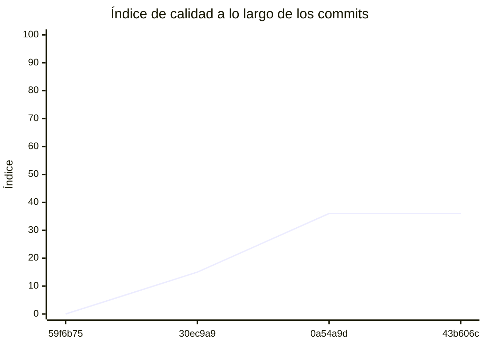

<!-- evaluacion:inicio -->
# Evaluación — prog-2-SQR/Frontend-KMP

> Documento **generado automáticamente** por la cátedra de Programación II (UM): RepoSense + análisis de calidad de **7 dimensiones**. **No editar a mano**: se regenera en cada evaluación.
> Rama evaluada: `main`. Análisis **heurístico** (regex + métricas) + build: es una criba para orientar la revisión, **no una nota**. La **documentación** del repositorio no se evalúa.
> Generado: 2026-10-19.

## 1. Veredicto

| Aspecto | Resultado |
|---|---|
| Índice de calidad | **36/100** |
| Tipo de repositorio | `app-kmp` |
| Build (`mvnw verify` / `gradlew check`) | OK |
| Código (LOC) | 473 |
| Archivos de código | 18 |
| Clases | 12 |
| Código dentro de clases (%POO) | 41% |
| Funciones fuera de clases | 0 |
| Duplicación (puerta) | 5.3% |
| Duplicación lógica | 5.4% |
| Duplicación de boilerplate | 0.0% |
| Tope duro aplicado a D1 | `POO_BAJO` → D1 ≤ 60 |

> Este informe **describe** lo que el análisis midió con los criterios ya establecidos de la materia. No es una nota.

## 2. Semáforo de aprobación

Criterios de la cátedra (`CRITERIOS-CALIDAD.md`): **Aprobar** se juega con el perfil `estandar`; **destacar**, con el `exigente` (meta de excelencia).

| Semáforo | Resultado |
|---|---|
| Aprobar (`estandar`) | **no cumple** — 5/11 |
| Destacar (`exigente`) | **no cumple** — 3/11 |

**Para aprobar, falta cumplir:** MVVM; Duplicación

**Para destacar, falta cumplir:** SOLID; POO; MVVM; Duplicación

## 3. Autoría (RepoSense)

| Autor | Commits | Código (LOC) | Tests (LOC) | Docs (LOC) | Días activos | % del código |
|---|---:|---:|---:|---:|---:|---:|
| Santiago Quiroga Rivarossa | 9 | 536 | 0 | 84 | 3 | 100% |

> _El LOC de autoría lo calcula RepoSense sobre el historial y puede diferir del LOC de código del análisis (que mira el estado de `main`)._

## 4. Dimensiones evaluadas

Cada dimensión indica **qué mide**, **por qué importa** y **tu resultado**. Cuando el puntaje queda por debajo de la referencia, se agregan preguntas para **investigar la causa** (no hay recetas).

| Dimensión | Peso | Puntaje |
|:--|--:|--:|
| **D1** Diseño OO, SOLID y patrones (20%) | 20% | 14 |
| **D2** Arquitectura hexagonal — backend (15%) | 15% | N/A |
| **D3** Frontend KMP: MVVM y buenas prácticas (10%) | 10% | 40 |
| **D4** Integración y contrato (10%) | 10% | N/A |
| **D5** Seguridad y robustez (10%) | 10% | 95 |
| **D6** Pruebas y cobertura (20%) | 20% | 7 |
| **D7** Proceso y entrega (15%) | 15% | 62 |

### D1. Diseño OO, SOLID y patrones (20%)

- **Qué mide:** Métricas orientadas a objetos (clases, métodos, campos, cohesión, acoplamiento, herencia) y proxies de SOLID, más patrones de diseño.
- **Por qué importa:** El eje de la materia es el buen uso de la POO y su arquitectura: un diseño con clases claras y poco acopladas es más fácil de entender, probar y cambiar.
- **Tu resultado:** **14/100**
- **Para investigar la causa:**
    - ¿Se pensó el modelo de clases antes de codificar o se agrupó después?
    - ¿Qué clases concentran muchas responsabilidades a la vez?
    - ¿Los colaboradores llegan como parámetros o se crean por dentro?

### D3. Frontend KMP: MVVM y buenas prácticas (10%)

- **Qué mide:** Uso de ViewModel, estado de UI y flujo unidireccional, y ausencia de acceso a red/BD dentro de la UI.
- **Por qué importa:** Separar la UI del estado y del acceso a datos hace la app más predecible, testeable y menos propensa a bugs de ciclo de vida.
- **Tu resultado:** **40/100**
- **Para investigar la causa:**
    - ¿Qué componente de UI hace trabajo que no le corresponde?
    - ¿El estado se modela de forma inmutable y con un único origen?
    - ¿Hay llamadas de red o de base de datos fuera de los repositorios?

### D5. Seguridad y robustez (10%)

- **Qué mide:** Credenciales embebidas, consultas SQL por concatenación, y presencia de config de entorno; aislamiento de secretos.
- **Por qué importa:** Un secreto en el repositorio o una consulta construida por concatenación son riesgos concretos, no hipotéticos.
- **Tu resultado:** **95/100**

### D6. Pruebas y cobertura (20%)

- **Qué mide:** Cantidad y resultado de pruebas y cobertura de línea (JaCoCo/Kover, Surefire/Failsafe) cuando hay build.
- **Por qué importa:** Las pruebas son la red de seguridad para refactorizar e integrar; la cobertura acota las zonas sin verificar.
- **Tu resultado:** **7/100**
- **Para investigar la causa:**
    - ¿Qué partes del sistema no tienen pruebas?
    - ¿Las pruebas cubren caminos de error o solo el caso feliz?
    - ¿Qué falla al ejecutar la suite completa (no solo la del módulo propio)?

### D7. Proceso y entrega (15%)

- **Qué mide:** Artefactos verificables de proceso/entrega: `compose`, `.env.example`, CI (`.github/workflows/`), `CODEOWNERS` y wrapper de build (`mvnw`/`gradlew`). **No** puntúa documentación.
- **Por qué importa:** Un proyecto que compila, se levanta y se valida solo es más fácil de revisar y de integrar en equipo.
- **Tu resultado:** **62/100**

## 5. Señales detectadas

El análisis encontró las siguientes señales (archivo, sin número de línea a propósito):

**SRP/responsabilidad** (3)
- clase 'AppColors' grande (LOC=18, métodos=0, campos=8) — `shared/src/commonMain/kotlin/ar/edu/um/prog2/quiroga/turnosapp/ui/theme/AppColors.kt`
- clase 'AppColors' sin métodos (8 campos): solo datos — `shared/src/commonMain/kotlin/ar/edu/um/prog2/quiroga/turnosapp/ui/theme/AppColors.kt`
- clase 'AppDestination' sin métodos (4 campos): solo datos — `shared/src/commonMain/kotlin/ar/edu/um/prog2/quiroga/turnosapp/ui/navigation/AppDestination.kt`

**DIP/concretos** (8)
- clase 'AppDestination' muy acoplada (CBO=9) — `shared/src/commonMain/kotlin/ar/edu/um/prog2/quiroga/turnosapp/ui/navigation/AppDestination.kt`
- clase 'AppDestination' instancia 4 concretos (CBO=9) — `shared/src/commonMain/kotlin/ar/edu/um/prog2/quiroga/turnosapp/ui/navigation/AppDestination.kt`
- clase 'HomeScreen' muy acoplada (CBO=12) — `shared/src/commonMain/kotlin/ar/edu/um/prog2/quiroga/turnosapp/ui/screens/HomeScreen.kt`
- clase 'HomeScreen' instancia 5 concretos (CBO=12) — `shared/src/commonMain/kotlin/ar/edu/um/prog2/quiroga/turnosapp/ui/screens/HomeScreen.kt`
- clase 'SettingsScreen' muy acoplada (CBO=13) — `shared/src/commonMain/kotlin/ar/edu/um/prog2/quiroga/turnosapp/ui/screens/SettingsScreen.kt`
- clase 'SettingsScreen' instancia 6 concretos (CBO=13) — `shared/src/commonMain/kotlin/ar/edu/um/prog2/quiroga/turnosapp/ui/screens/SettingsScreen.kt`
- clase 'MainScreen' muy acoplada (CBO=14) — `shared/src/commonMain/kotlin/ar/edu/um/prog2/quiroga/turnosapp/ui/screens/MainScreen.kt`
- clase 'MainScreen' instancia 11 concretos (CBO=14) — `shared/src/commonMain/kotlin/ar/edu/um/prog2/quiroga/turnosapp/ui/screens/MainScreen.kt`

**POO** (2)
- clase 'AppDestination' con 4 campos públicos (encapsulación) — `shared/src/commonMain/kotlin/ar/edu/um/prog2/quiroga/turnosapp/ui/navigation/AppDestination.kt`
- clase 'MainScreen' con 7 campos públicos (encapsulación) — `shared/src/commonMain/kotlin/ar/edu/um/prog2/quiroga/turnosapp/ui/screens/MainScreen.kt`

**duplicación** (3)
- duplicación lógica: 5.3% · boilerplate: 0.0%
- bloque de 8 líneas repetido 2 veces en settings.gradle.kts:5, settings.gradle.kts:19 — `settings.gradle.kts`
- bloque de 8 líneas repetido 2 veces en settings.gradle.kts:4, settings.gradle.kts:18 — `settings.gradle.kts`

## 6. Evolución por commit

Métricas calculadas sobre el estado de `main` en **cada commit** (4 commits con trabajo), del primero al último. La calidad usa el perfil `exigente`; el aporte de código lo mide RepoSense. El índice puede **bajar** al crecer el proyecto: se acumulan señales.

| # | Fecha | Commit | Autor | LOC | Índice | %POO | Duplic. | Sueltas |
|---|---|---|---|---:|---:|---:|---:|---:|
| 1 | 2026-09-10 | `59f6b75` | Ing. Daniel Quinteros | 0 | 0 | 0% | 0.0% | 0 |
| 2 | 2026-09-10 | `30ec9a9` | Ing. Daniel Quinteros | 0 | 15 | 0% | 0.0% | 0 |
| 3 | 2026-10-16 | `0a54a9d` | Santiago Quiroga Rivarossa | 275 | 36 | 23% | 8.4% | 0 |
| 4 | 2026-10-18 | `43b606c` | Santiago Quiroga Rivarossa | 473 | 36 | 41% | 5.3% | 0 |

---
_Informe generado por la cátedra. Las dimensiones y umbrales corresponden a `calidad.py` (perfil `exigente`); el semáforo, a `CRITERIOS-CALIDAD.md`. La documentación del repositorio no se evalúa. Ante dudas, revisá el archivo señalado._
<!-- evaluacion:fin -->
