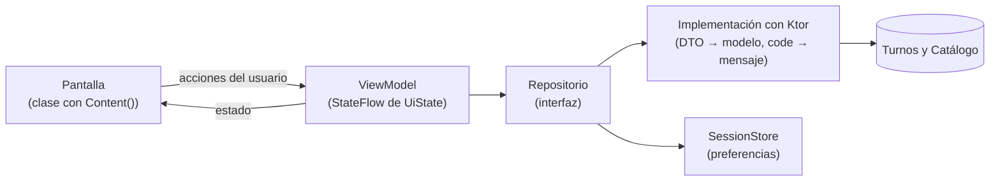

# PLAN: Frontend-KMP

Cómo se construyó la app que describe [SPEC.md](SPEC.md): arquitectura, orden de trabajo y decisiones. Las tareas una por una están en [TASKS.md](TASKS.md).

## Arquitectura

**MVVM**, con toda la app en `shared/src/commonMain`. El módulo `androidApp` solo muestra `App()`.



- **Pantallas**: clases con un `Content()` (el estilo del profesor). Solo dibujan el `UiState` y le avisan al ViewModel lo que hace el usuario. Ninguna sabe de HTTP ni de almacenamiento.
- **ViewModels**: uno por pantalla, más `SessionViewModel` para la sesión de toda la app. Exponen un `StateFlow` inmutable y lanzan el trabajo en `viewModelScope`.
- **Repositorios**: interfaces (`AuthRepository`, `ProfessionalRepository`, `AppointmentRepository`) de las que dependen los ViewModels. Las implementaciones con Ktor pasan los DTO al modelo y los `code` de problem+json a mensajes. En los tests se reemplazan por repositorios falsos.
- **Navegación**: Navigation Compose con barra inferior. Buscar y Mis reservas son grafos anidados (lista y detalle), con rutas con tipo (`@Serializable`). Sin sesión se ven login y registro; con sesión, las pestañas.

```
ar.edu.um.prog2.quiroga.turnosapp
├── ui/{theme,navigation,components,screens,format}
├── viewmodel/
├── data/{remote,repository,local}
└── domain/{model,validation}
```

## Etapas

| Milestone | Objetivo | Resultado |
|---|---|---|
| M0 · Setup e infraestructura | Proyecto generado con el KMP Wizard, solo Android | Version catalog, CI con `./gradlew build` |
| M8 · App KMP | La app completa contra los dos backends | Navegación, cuentas, búsqueda, turnos y reserva, mis reservas, teléfono, cancelación y sesión |
| M9 · Documentación y evidencias | Entrega documentada | SPEC/PLAN/TASKS |

## Decisiones

| Decisión | Por qué |
|---|---|
| Dependencias solo en el version catalog (`gradle/libs.versions.toml`) | Una sola fuente de versiones, como pide la cátedra |
| Ktor con OkHttp en Android y `MockEngine` en los tests | Cliente multiplataforma: los tests de los repositorios no necesitan un servidor |
| `kotlinx-datetime` para fechas y horas | Las fechas viajan como `yyyy-MM-dd` y las horas como `HH:mm:ss` (anexo §4), y se leen sin conversiones a mano |
| Calendario de Material 3 (30 días) y turnos en mañana y tarde | La primera versión, una fila de 14 días, dejaba mucho espacio vacío y botones chicos (probado en el emulador) |
| **Consultar el estado cada 3 s** en lugar de SSE | Turnos no tiene SSE (recorte del plan). Se consulta solo mientras la reserva está en curso, con una sola consulta a la vez |
| Sesión con multiplatform-settings y lectura del `exp` del JWT | "Recordarme" sin pasar el `Context` de Android, y sin restaurar un token vencido |
| La sesión en un `SessionViewModel` | Sobrevive a la rotación, y se puede testear sin pantalla |

## Estrategia de pruebas

- **ViewModels**: con repositorios falsos y `Dispatchers.setMain`. El seguimiento cada 3 s usa un reloj virtual (`TestCoroutineScheduler`), así los tests no esperan.
- **Repositorios**: con `MockEngine`, que verifica la ruta, el token y el body de cada request, y la traducción de cada `code` a su mensaje.
- **Modelo y formato**: reglas de validación, paginación y textos de fechas.
- **CI**: `./gradlew build` (compilación, tests y lint) en cada push y PR, con cobertura de Kover. La cátedra no exige CI ni cobertura para la app (Slack 22/10), pero ya estaban y no molestan.
