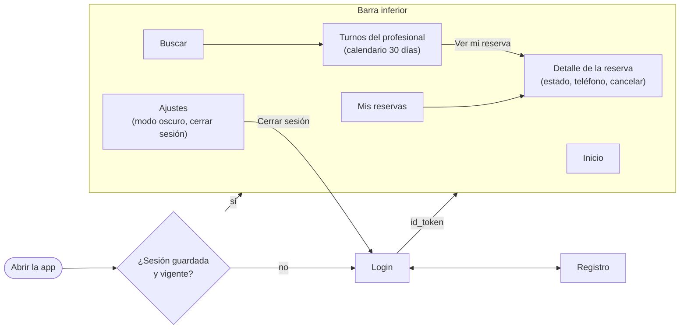

# SPEC: Frontend-KMP

Qué hace la app, qué pantallas tiene y qué usa de cada backend. El cómo se construyó está en [PLAN.md](PLAN.md), y el detalle de cada tarea, en [TASKS.md](TASKS.md).

## Propósito

App Android (Kotlin Multiplatform y Compose Multiplatform) para que los usuarios finales se registren, busquen profesionales, vean los turnos libres, reserven, sigan el estado de su reserva hasta el resultado y cancelen un turno confirmado. **Nunca habla con la cátedra**: todo pasa por los dos backends del proyecto (enunciado §3.2).

## Requisitos que cubre

| Enunciado | Requisito | Pantalla |
|---|---|---|
| §5 punto 1 | Registrarse e iniciar sesión con JWT | Login y Registro |
| §5 punto 7 | Buscar y filtrar profesionales (categoría, nombre, habilitado y día) | Buscar |
| §5 puntos 8 a 10 | Ver los turnos libres y reservar uno | Turnos del profesional |
| §5 punto 11 | Responder el pedido de teléfono | Detalle de la reserva |
| §5 punto 12 | Ver el resultado final | Detalle de la reserva |
| §5 punto 13 | Consultar las reservas propias | Mis reservas |
| §5 punto 14 | Cancelar una reserva propia confirmada | Detalle de la reserva |

## Pantallas y flujo

| Pantalla | Qué muestra y qué permite |
|---|---|
| Login | Usuario, contraseña y "Recordarme". Lleva al registro |
| Registro | Usuario, contraseña (dos veces), nombre, apellido y email opcional, validados con las mismas reglas que Turnos |
| Buscar | Lista paginada de profesionales, con filtros por nombre, categoría, día de atención y solo habilitados |
| Turnos del profesional | Calendario de hoy a 30 días, con los turnos libres del día separados en mañana y tarde. Al confirmar, reserva; si la cuenta no tiene nombre y apellido, los pide |
| Mis reservas | Las reservas propias, de la más nueva a la más vieja, con el nombre del profesional, la fecha y el estado |
| Detalle de la reserva | El estado, que se actualiza cada 3 s mientras está en curso; el pedido de teléfono con el mensaje de la cátedra y el motivo de un rechazo; "Cancelar turno" si está confirmada |
| Ajustes | Modo oscuro y "Cerrar sesión" |

## Lo que usa de cada backend

| Backend | Operación | Para qué |
|---|---|---|
| Turnos `:8081` | `POST /api/register`, `POST /api/authenticate` | Cuenta y JWT |
| Turnos | `GET /api/availability` | Turnos libres de un día |
| Turnos | `POST /api/reservations`, `GET /api/reservations`, `GET /api/reservations/{id}` | Reservar y seguir el estado |
| Turnos | `POST /api/reservations/{id}/phone`, `POST /api/reservations/{id}/cancel` | Teléfono y cancelación |
| Catálogo `:8080` | `GET /api/professionals/search`, `GET /api/categories` | Búsqueda y filtros |
| Catálogo | `GET /api/professionals/{id}` | Nombre del profesional en Mis reservas |

- Todas las llamadas, salvo registro y login, llevan el mismo JWT, que sirve en los dos backends porque comparten el secreto.
- Desde el emulador, la PC se ve como `10.0.2.2` ([`ApiConfig`](../shared/src/commonMain/kotlin/ar/edu/um/prog2/quiroga/turnosapp/data/remote/ApiConfig.kt)).

## Estado local

- **Sesión**: login y token. Con "Recordarme" se guardan en las preferencias privadas de la app y se restauran al abrirla mientras el token no haya vencido (se lee su `exp`). Cerrar sesión los borra.
- La app **no guarda una copia** del catálogo ni de las reservas: todo se pide al backend en el momento.

## Errores

- Los backends responden `application/problem+json` con un `code`. La app pasa cada `code` a un mensaje en castellano (por ejemplo, `SLOT_ALREADY_HELD` → "Ese turno ya no está libre. Elegí otro.") y nunca muestra el `detail` interno.
- Sin conexión, la app avisa que no pudo conectar, sin cerrarse. Un `401` dice que la sesión venció.
